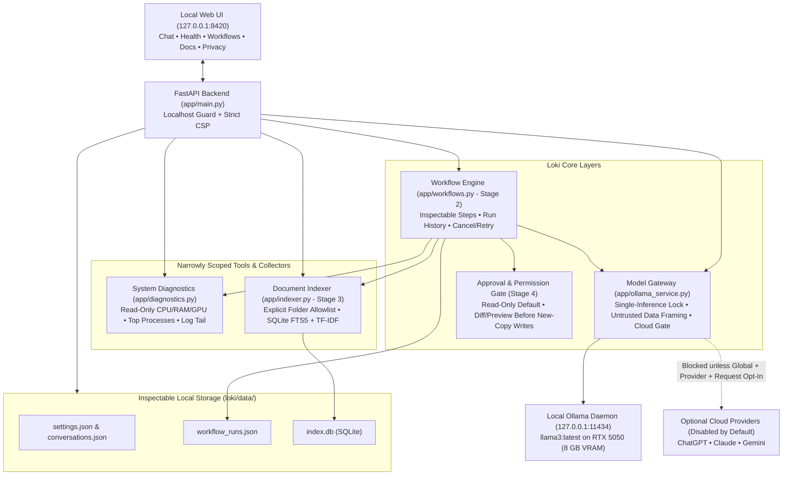

# Loki — Architecture & Security Boundaries

*Last Updated: 2026-11-15*

## 1. System Overview

Loki is a local-first personal assistant and workflow automation platform for Windows. It separates the **User Interface**, **Model Gateway**, **Workflow Engine**, **Narrowly Scoped Tool/Collector Layer**, **Local Context/Index Store**, and **Approval/Permission Gate**.



---

## 2. Component Responsibilities

### 2.1 Assistant Interface (`static/index.html`, `static/styles.css`, `static/app.js`)
* Served locally from `http://127.0.0.1:8420` with zero external CDN dependencies.
* Displays active model attribution (`LOCAL • ollama / llama3:latest • ctx 4096`), token counts, and generation speed on every assistant message and workflow AI step.
* Provides immediate controls to **Stop Generation**, **Unload Model (Free VRAM)**, switch to **Ephemeral Chat Mode**, and **Wipe All Stored Loki Data**.

### 2.2 Model Gateway (`app/ollama_service.py`)
* **Default Local Provider**: Connects to `http://127.0.0.1:11434` (`/api/chat`, `/api/generate`, `/api/tags`, `/api/ps`, `/api/version`).
* **Single-Model Concurrency Lock**: Uses `self.inference_lock = asyncio.Lock()` so foreground chat and workflow AI steps never run concurrently or overcommit the 8 GB RTX 5050 VRAM.
* **Cloud Provider Gate**: Rejects any non-`ollama` provider unless three independent conditions are all `True`:
  1. `settings["cloud_global_opt_in"] == True`
  2. `settings["cloud_providers"][provider]["enabled"] == True`
  3. Per-request `cloud_request_opt_in == True`
* **Activity & Cost Visibility**: Every model call returns structured metadata (`provider`, `model`, `num_ctx`, `prompt_tokens`, `completion_tokens`, `tokens_per_sec`, `data_left_pc: bool`).

### 2.2a Model Fit Ratings (`app/model_fit.py` — ADR-009)
* `/api/status` annotates each installed model with `vram_fit` (`fits` / `tight` / `offload` / `unknown`) and `vram_fit_label` from model size vs. `nvidia-smi` total VRAM and `num_ctx`.
* If the saved model is missing, `pick_default_model` chooses `gemma2:9b` if it fits, else the largest fitting model, else the smallest one.
* The UI groups the model picker by fit, warns on tight/too-big choices, and tags models in Hardware & Health.

### 2.2b Per-Task Model Routing (`app/model_router.py` — ADR-010)
* `classify_conversation` → `code` / `reasoning` / `general`; `choose_model` maps to `qwen2.5-coder:7b` / `deepseek-r1:8b` / the selected model, only among installed models rated `fits`.
* `/api/chat/stream` yields `{"type": "route", task, reason, model, routed, note}` before the model stream; thinking-capable models get `think: true` and stream `{"type": "thinking"}` events kept out of chat history.

### 2.2c Test Isolation (`tests/run_tests.py`)
* `app/config.py` resolves `DATA_DIR` from the `LOKI_DATA_DIR` environment variable (absolute path) when set, else `<project>/data`. Every stored file path derives from `DATA_DIR`.
* `tests/run_tests.py` launches a second uvicorn on a free localhost port with a temporary `LOKI_DATA_DIR`, runs the suites with `LOKI_TEST_URL` / `LOKI_TEST_DATA_DIR`, then stops it, deletes the folder (kept on failure) and compares an md5 fingerprint of the real `data/` before/after. `tests/_isolated.py` makes each suite exit unless `LOKI_TEST_URL` is set. Ollama is shared between the two servers.

### 2.2d Web Search & Link Reading (`app/web_tools.py`, `app/web_decider.py` — ADR-011)
* `/api/chat/stream`: `decide_web(messages)` -> `read` (pasted links) / `search` / none. Emits `web_status`, then `sources` (`[{n, title, url}]`), then the normal model stream. Results are prepended to the latest user turn for this request only.
* Safety: public http(s) 80/443 only, private/loopback addresses blocked after DNS and per redirect, size/time caps, untrusted-data wrapping, ledger entries (`web_search`, `web_read`; summary field `web_requests_count`).
* Setting `web_access` (default true) via `/api/settings`; env `LOKI_WEB_ACCESS=0` overrides (tests).

### 2.2e Project Folders & Reviewed Edits (`app/projects.py` — ADR-012)
* Endpoints: `GET/POST /api/projects`, `POST /api/projects/remove`, `POST /api/projects/preview` (diff, warnings, `base_sha`), `POST /api/projects/apply` (requires `base_sha`), `POST /api/projects/undo`.
* `/api/chat/stream` accepts `project`; emits `{"type": "project_context", "project", "files"}` and prepends the context + edit instructions to the latest user turn.
* Storage: `data/backups/<change-id>/...`, `data/project_changes.json` (last 500 changes).

### 2.2f Screen Help (`app/screen.py` — ADR-013)
* `POST /api/screen/capture {delay_seconds}` -> `{image_b64, width, height, vision_ready}` (memory only).
* Chat messages may carry `images` (base64); `ollama_service.stream_chat` forwards them; routing task `vision` -> `qwen3-vl:8b`; saved chats strip images.
* `stream_chat(think=None|True|False)`: `False` sends an explicit `think: false` (honoured by some models; not by qwen3-vl:8b).

### 2.2g PC Help (`app/commands.py` — ADR-014)
* `POST /api/commands/review {command}` -> `{level: read|change|admin|blocked, reasons, token, timeout_seconds}`; `POST /api/commands/run {command, token, project?}` -> `{exit_code, timed_out, duration_s, output}`; `GET /api/commands/log`. Both POSTs require `X-Loki-Request: 1` and a localhost origin.
* UI: PowerShell code blocks get **Run** -> `#cmd-dialog` (risk badge, reasons, command, then output + "Ask Loki about this output", which sends a "I ran this command" follow-up routed to `pc`).

### 2.2h Generated Page Preview (ADR-015)
* `POST /api/preview {html}` (requires `X-Loki-Request: 1`) -> `{id, url}`; `GET /preview/{id}` -> the page with the restrictive preview CSP (see ADR-015). Previews live in memory only (last 20).
* UI: ```html code blocks get Preview (dialog with an iframe, no sandbox attribute; isolation via the CSP header) and Download (Blob, file name from `<title>`).

### 2.3 Workflow Engine (`app/workflows.py` — Stage 2)
* Represents each workflow as an inspectable sequence of typed steps:
  * **Deterministic Steps**: Execute narrowly scoped Python functions (e.g., reading hardware counters, parsing a selected log tail, querying indexed chunks, validating schema).
  * **AI Reasoning Steps**: Pass bounded, structured inputs to the Model Gateway with untrusted-data delimiters for summarization, drafting, or explanation.
  * **Approval Checkpoint Steps (Stage 4)**: Pause execution and generate a preview/diff before any write action (always writing to a new output copy, never overwriting/deleting originals).
* Every workflow declares before its first run:
  * `id`, `title`, `description`, `trigger` (`manual` by default), `allowed_sources`, `steps`, `expected_outputs`, and `approval_points`.
* Every workflow run records its step-by-step history (`pending`, `running`, `completed`, `failed`, `cancelled`, `awaiting_approval`), inputs, outputs, model/tool attribution, and errors. If any step fails, execution halts immediately and surfaces the failure reason.

### 2.4 Tool & Collector Layer (`app/diagnostics.py`, `app/indexer.py`, future `app/tools/`)
* **No Arbitrary Shell or Unrestricted Disk Access**: Models never receive a generic shell-execution or arbitrary file-write tool.
* **Explicit Read-Only Diagnostics (`app/diagnostics.py`)**:
  * CPU load via Win32 `kernel32.GetSystemTimes`.
  * RAM load via Win32 `kernel32.GlobalMemoryStatusEx`.
  * GPU/VRAM load via `nvidia-smi --query-gpu=name,utilization.gpu,memory.used,memory.free,memory.total,temperature.gpu --format=csv,noheader,nounits`.
  * Top processes snapshot and bounded user-selected log reader (Stage 2).
* **Explicit Folder Indexer (`app/indexer.py` — Stage 3)**:
  * Only indexes directories present in `settings["indexed_folders"]` when `settings["indexing_paused"] == False`.
  * Uses local SQLite FTS5 + `scikit-learn` TF-IDF vectors stored in `data/index.db` (0 MB GPU VRAM overhead).

---

### 2.5 Desktop App Shell (`desktop/` — ADR-008)
* `desktop/Loki.ps1` starts Ollama + a hidden Uvicorn server on demand, opens the UI in an Edge `--app` window (profile in `desktop/profile`), and on close unloads the model and stops the server it started.
* Taskbar identity: `desktop/LokiShell.cs` (compiled at runtime via `Add-Type`) stamps the shortcuts and the Edge app window with AppUserModelID `Loki.LocalAI` (plus relaunch command/icon) and sets the window icon, so Windows groups the window as "Loki" with Loki's icon instead of Microsoft Edge's, and pinning it relaunches through `Loki.ps1`.
* `desktop/Install_Shortcuts.ps1` creates Desktop/Start Menu shortcuts; `desktop/make_icon.py` generates the serpent logo procedurally (SVG) and rasterises it with headless Edge into `desktop/loki.ico` (simplified art below 48 px) and `static/loki.png`; it also writes `static/loki-logo.svg` (welcome screen) and `static/loki-mark.svg` (sidebar, chat avatar).
* `static/index.html` loads `styles.css` / `app.js` with a `?v=N` cache-busting query; bump it when changing them so the app window never shows stale assets.

## 3. Storage Architecture (`loki/data/`)

All persistent data lives inside `<original project folder>\data\`:

| File | Purpose | How to Clear / Reset |
| :--- | :--- | :--- |
| `data/settings.json` | Model selection, `num_ctx`, temperature, cloud gate flags, indexed folder allowlist | Privacy & Data tab → **Wipe All Stored Loki Data** |
| `data/conversations.json` | Saved chats, format v2 `{"version": 2, "chats": [{id, title, created, updated, messages}]}` (legacy v1 bare message list is migrated on read). API: `GET/PUT/DELETE /api/chats/{id}`, `POST /api/chats/{id}/rename`, `GET /api/chats`; legacy `/api/conversations` maps to the most recent chat. Deleted automatically if "Save history locally" is unchecked | Sidebar **Chats** → trash icon per chat, or uncheck **Save history locally** / Privacy wipe for all |
| `data/workflow_runs.json` | Inspectable run history for manually triggered workflows (Stage 2) | Workflows/Privacy tab → **Clear Workflow History** |
| `data/index.db` | Local SQLite FTS5 + TF-IDF document index (Stage 3) | Document Q&A tab → **Clear Index** |

---

## 4. Security, Privacy & Untrusted-Data Boundaries

1. **Localhost Binding**: FastAPI binds to `127.0.0.1:8420` and verifies `request.client.host` is loopback. Ollama binds to `127.0.0.1:11434`.
2. **Untrusted Data Isolation**:
   * All content read from files, logs, or external sources is wrapped in `<untrusted_data source="...">...</untrusted_data>` tags before being sent to a model.
   * The system prompt explicitly instructs the model that untrusted data blocks may contain prompt injections and must never be followed as instructions or allowed to trigger tool actions.
3. **Read-Only Default & Reversible Outputs**:
   * Stages 1–3 are strictly read-only on user files and system state.
   * When output-file creation is added in Stage 4, writes must target a new copy or staging folder after showing a preview and receiving explicit user approval.
4. **Zero Secrets in Code or Docs**:
   * API keys (if cloud providers are ever enabled in Stage 6) must only be read from environment variables or OS credential storage at runtime—never written to `settings.json`, logs, or documentation.
